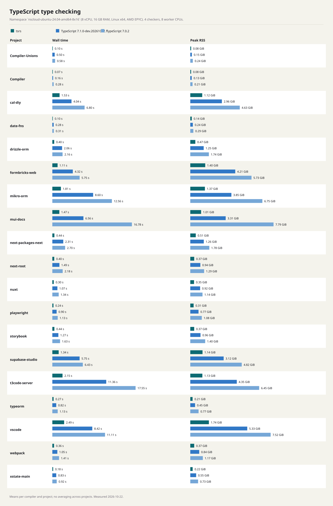

# Benchmark results

<!-- Generated by `node bench/bench.mjs render`; edit bench/release.mjs, not this file. -->

npm release binaries, measured 2026-10-27: TypeScript 7.1.0-beta (`@typescript/typescript-darwin-arm64`) and tsrs 0.20.0-ts7.1.0-beta (`@tsrs/darwin-arm64`), which ports microsoft/TypeScript@3e9236361fa9. tsrs runs in its default mode and with the fast preset (`--fast`).

Each command is `-p <project> --noEmit --incremental false --pretty false`, plus `--fast` for tsrs --fast, on an Apple M3 Max (14 cores, 36 GB, Darwin arm64). Default-settings runs pass no `--checkers` and set no thread limit, so each compiler picks its own checker count and uses all 14 cores. Values are medians of 10 interleaved runs (5 for TypeScript), measured with Hyperfine 2.0.0. An untimed run of every command first warms the file cache and records its diagnostics. Each timed run waits until other processes use at most 1.5 CPU cores, for up to 900 s; 0 of 475 runs started after that wait expired.

The bar chart and tables compare all three with default settings. The chart shows the 6 projects with the largest tsrs --fast wall-time speedup over TypeScript; the tables include all 19 projects. Pinned projects are in [projects.json](projects.json); see the [methodology](README.md).

## Default settings

**Wall time**

| project | TypeScript 7.1 beta | tsrs | tsrs --fast | tsrs vs TypeScript | tsrs --fast vs TypeScript |
| --- | ---: | ---: | ---: | ---: | ---: |
| t3code-server | 7.12 s | 1.70 s | 1.19 s | 4.19x faster | 5.98x faster |
| vscode | 5.08 s | 1.98 s | 0.85 s | 2.56x faster | 5.96x faster |
| mikro-orm | 4.60 s | 1.37 s | 0.70 s | 3.35x faster | 6.56x faster |
| mui-docs | 4.03 s | 1.43 s | 1.06 s | 2.82x faster | 3.79x faster |
| supabase-studio | 4.01 s | 1.46 s | 0.78 s | 2.75x faster | 5.11x faster |
| formbricks-web | 3.34 s | 1.18 s | 0.71 s | 2.84x faster | 4.72x faster |
| cal-diy | 2.85 s | 1.02 s | 0.71 s | 2.80x faster | 3.99x faster |
| next-packages-next | 1.46 s | 0.52 s | 0.23 s | 2.82x faster | 6.27x faster |
| next-root | 1.22 s | 0.52 s | 0.38 s | 2.33x faster | 3.22x faster |
| nuxt | 0.72 s | 0.30 s | 0.22 s | 2.41x faster | 3.27x faster |
| webpack | 0.71 s | 0.27 s | 0.14 s | 2.64x faster | 4.92x faster |
| storybook | 0.71 s | 0.27 s | 0.18 s | 2.57x faster | 3.87x faster |
| drizzle-orm | 0.69 s | 0.24 s | 0.16 s | 2.93x faster | 4.38x faster |
| playwright | 0.60 s | 0.22 s | 0.14 s | 2.69x faster | 4.34x faster |
| typeorm | 0.48 s | 0.24 s | 0.18 s | 2.03x faster | 2.72x faster |
| xstate-main | 0.45 s | 0.18 s | 0.12 s | 2.57x faster | 3.69x faster |
| date-fns | 0.31 s | 0.16 s | 0.13 s | 1.94x faster | 2.32x faster |
| Compiler-Unions | 0.28 s | 0.10 s | 0.10 s | 2.75x faster | 2.78x faster |
| Compiler | 0.14 s | 0.07 s | 0.07 s | 1.96x faster | 1.90x faster |

**Peak memory**

| project | TypeScript 7.1 beta | tsrs | tsrs --fast | tsrs vs TypeScript | tsrs --fast vs TypeScript |
| --- | ---: | ---: | ---: | ---: | ---: |
| t3code-server | 4.38 GiB | 1.82 GiB | 1.95 GiB | 2.40x less | 2.24x less |
| vscode | 5.48 GiB | 2.36 GiB | 2.00 GiB | 2.32x less | 2.73x less |
| mikro-orm | 4.15 GiB | 1.60 GiB | 1.79 GiB | 2.60x less | 2.32x less |
| mui-docs | 3.07 GiB | 1.29 GiB | 1.47 GiB | 2.38x less | 2.08x less |
| supabase-studio | 3.15 GiB | 1.38 GiB | 1.54 GiB | 2.29x less | 2.04x less |
| formbricks-web | 4.00 GiB | 1.92 GiB | 1.82 GiB | 2.09x less | 2.20x less |
| cal-diy | 3.02 GiB | 1.31 GiB | 1.71 GiB | 2.30x less | 1.77x less |
| next-packages-next | 1.35 GiB | 623 MiB | 639 MiB | 2.22x less | 2.17x less |
| next-root | 1.01 GiB | 508 MiB | 500 MiB | 2.03x less | 2.06x less |
| nuxt | 903 MiB | 428 MiB | 492 MiB | 2.11x less | 1.84x less |
| webpack | 860 MiB | 405 MiB | 483 MiB | 2.12x less | 1.78x less |
| storybook | 924 MiB | 446 MiB | 475 MiB | 2.07x less | 1.95x less |
| drizzle-orm | 896 MiB | 414 MiB | 530 MiB | 2.16x less | 1.69x less |
| playwright | 759 MiB | 361 MiB | 449 MiB | 2.10x less | 1.69x less |
| typeorm | 463 MiB | 236 MiB | 253 MiB | 1.97x less | 1.83x less |
| xstate-main | 561 MiB | 267 MiB | 250 MiB | 2.10x less | 2.25x less |
| date-fns | 406 MiB | 182 MiB | 192 MiB | 2.23x less | 2.12x less |
| Compiler-Unions | 159 MiB | 82 MiB | 82 MiB | 1.94x less | 1.94x less |
| Compiler | 144 MiB | 78 MiB | 77 MiB | 1.85x less | 1.87x less |

## Diagnostics

TypeScript, tsrs and tsrs --fast report identical diagnostics (file, position and code) for every project. Errors: t3code-server 6, vscode 371, mikro-orm 11, mui-docs 0, supabase-studio 9, formbricks-web 0, cal-diy 136, next-packages-next 3, next-root 4, nuxt 1, webpack 840, storybook 94, drizzle-orm 32, playwright 0, typeorm 31, xstate-main 0, date-fns 0, Compiler-Unions 41, Compiler 43.
