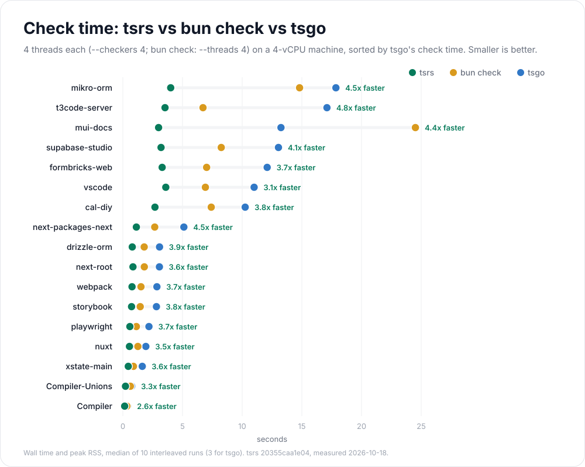
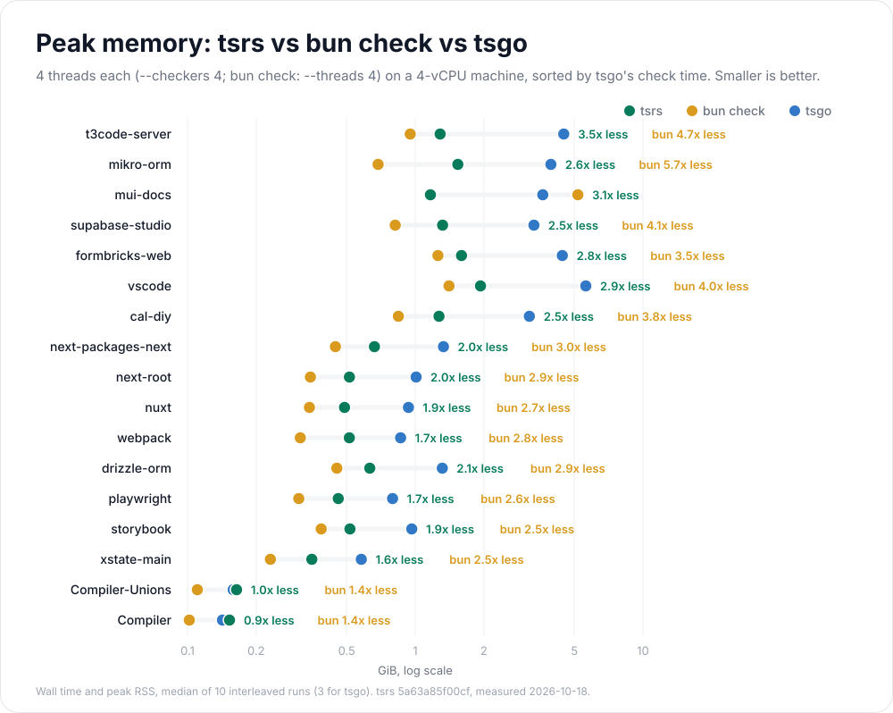

# Benchmark results

Measured 2026-10-22T15:36:00.413Z on Namespace `nscloud-ubuntu-24.04-amd64-8x16` (8 vCPU, 16 GB RAM, Linux x64, AMD EPYC).

Arithmetic means of 10 runs after 3 warmups per compiler and project. Projects are never averaged together.

4 checkers and 8 worker CPUs per compiler.

tsrs commit: `a70bc1890113c066f4b5781898b1a3604dcf0e3c`.

[Benchmark run and raw-data artifacts](https://github.com/oxc-project/tsrs/actions/runs/39803245995).

[Methodology](README.md).

<picture>
  <source media="(prefers-color-scheme: dark)" srcset="large-projects-dark.svg">
  
</picture>

<picture>
  <source media="(prefers-color-scheme: dark)" srcset="per-project-time-dark.svg">
  
</picture>

<picture>
  <source media="(prefers-color-scheme: dark)" srcset="per-project-memory-dark.svg">
  
</picture>

| Project | Compiler | Wall time | Peak memory | Instructions | Files | Diagnostics |
| --- | --- | ---: | ---: | ---: | ---: | ---: |
| Compiler-Unions | tsrs | 0.112 s | 0.079 GiB | 3,301,806,842 | 48 | 41 |
| Compiler-Unions | TypeScript 7.1.0-dev.20261022.1 | 0.348 s | 0.147 GiB | 10,452,690,051 | 48 | 41 |
| Compiler-Unions | TypeScript 7.0.2 | 0.651 s | 0.237 GiB | 15,785,551,995 | 48 | 41 |
| Compiler | tsrs | 0.079 s | 0.076 GiB | 1,757,910,607 | 53 | 43 |
| Compiler | TypeScript 7.1.0-dev.20261022.1 | 0.208 s | 0.132 GiB | 4,524,561,587 | 53 | 43 |
| Compiler | TypeScript 7.0.2 | 0.353 s | 0.211 GiB | 8,306,710,046 | 53 | 43 |
| cal-diy | tsrs | 2.049 s | 1.119 GiB | 41,876,352,824 | 10173 | 136 |
| cal-diy | TypeScript 7.1.0-dev.20261022.1 | 4.535 s | 2.915 GiB | 144,171,111,491 | 10173 | 136 |
| cal-diy | TypeScript 7.0.2 | 6.060 s | 4.621 GiB | 216,620,566,940 | 10166 | 136 |
| date-fns | tsrs | 0.092 s | 0.140 GiB | 1,489,957,440 | 2277 | 1 |
| date-fns | TypeScript 7.1.0-dev.20261022.1 | 0.268 s | 0.243 GiB | 6,173,525,625 | 2277 | 1 |
| date-fns | TypeScript 7.0.2 | 0.320 s | 0.286 GiB | 6,736,883,700 | 2270 | 1 |
| drizzle-orm | tsrs | 0.023 s | 0.085 GiB | 879,816,937 | 1554 | 2 |
| drizzle-orm | TypeScript 7.1.0-dev.20261022.1 | 0.089 s | 0.156 GiB | 3,425,855,307 | 1554 | 2 |
| drizzle-orm | TypeScript 7.0.2 | 0.333 s | 0.445 GiB | 15,948,522,659 | 1554 | 2 |
| formbricks-web | tsrs | 1.385 s | 1.396 GiB | 43,754,471,463 | 10458 | 0 |
| formbricks-web | TypeScript 7.1.0-dev.20261022.1 | 4.613 s | 4.237 GiB | 165,756,524,950 | 10458 | 0 |
| formbricks-web | TypeScript 7.0.2 | 6.811 s | 5.729 GiB | 232,124,059,596 | 10451 | 0 |
| mikro-orm | tsrs | 2.376 s | 1.310 GiB | 55,361,532,933 | 2820 | 11 |
| mikro-orm | TypeScript 7.1.0-dev.20261022.1 | 6.781 s | 3.940 GiB | 238,311,701,667 | 2820 | 11 |
| mikro-orm | TypeScript 7.0.2 | 13.327 s | 6.808 GiB | 382,711,947,985 | 2820 | 2 |
| mui-docs | tsrs | 1.076 s | 1.014 GiB | 50,901,708,055 | 16766 | 0 |
| mui-docs | TypeScript 7.1.0-dev.20261022.1 | 5.634 s | 3.314 GiB | 215,125,058,578 | 16766 | 0 |
| mui-docs | TypeScript 7.0.2 | 14.578 s | 7.931 GiB | 565,203,184,464 | 16766 | 0 |
| next-packages-next | tsrs | 0.829 s | 0.536 GiB | 16,829,813,219 | 2898 | 3 |
| next-packages-next | TypeScript 7.1.0-dev.20261022.1 | 3.054 s | 1.337 GiB | 62,067,952,120 | 2898 | 3 |
| next-packages-next | TypeScript 7.0.2 | 4.768 s | 1.890 GiB | 84,644,932,370 | 2891 | 3 |
| next-root | tsrs | 0.321 s | 0.409 GiB | 13,320,157,266 | 4001 | 4 |
| next-root | TypeScript 7.1.0-dev.20261022.1 | 1.160 s | 1.023 GiB | 42,695,311,595 | 4001 | 4 |
| next-root | TypeScript 7.0.2 | 1.531 s | 1.440 GiB | 58,073,940,318 | 3994 | 7 |
| nuxt | tsrs | 0.342 s | 0.353 GiB | 9,532,705,187 | 3705 | 1 |
| nuxt | TypeScript 7.1.0-dev.20261022.1 | 1.306 s | 0.906 GiB | 36,294,517,475 | 3705 | 1 |
| nuxt | TypeScript 7.0.2 | 1.830 s | 1.146 GiB | 46,945,995,303 | 3705 | 3 |
| playwright | tsrs | 0.306 s | 0.310 GiB | 8,073,214,917 | 1527 | 0 |
| playwright | TypeScript 7.1.0-dev.20261022.1 | 1.097 s | 0.762 GiB | 29,134,395,552 | 1527 | 0 |
| playwright | TypeScript 7.0.2 | 1.550 s | 1.059 GiB | 44,284,184,048 | 1520 | 0 |
| storybook | tsrs | 0.293 s | 0.367 GiB | 10,928,663,214 | 3548 | 93 |
| storybook | TypeScript 7.1.0-dev.20261022.1 | 1.480 s | 0.932 GiB | 40,331,490,620 | 3548 | 93 |
| storybook | TypeScript 7.0.2 | 2.215 s | 1.383 GiB | 60,709,449,173 | 3541 | 93 |
| supabase-studio | tsrs | 1.486 s | 1.147 GiB | 50,305,297,363 | 12553 | 9 |
| supabase-studio | TypeScript 7.1.0-dev.20261022.1 | 4.746 s | 3.099 GiB | 187,184,438,079 | 12553 | 9 |
| supabase-studio | TypeScript 7.0.2 | 7.064 s | 4.818 GiB | 273,739,101,928 | 12546 | 0 |
| t3code-server | tsrs | 1.529 s | 1.132 GiB | 60,293,777,727 | 2948 | 6 |
| t3code-server | TypeScript 7.1.0-dev.20261022.1 | 8.577 s | 4.327 GiB | 348,144,535,910 | 2948 | 6 |
| t3code-server | TypeScript 7.0.2 | 11.450 s | 6.355 GiB | 472,198,746,123 | 2941 | 5 |
| typeorm | tsrs | 0.286 s | 0.214 GiB | 5,934,289,386 | 3575 | 31 |
| typeorm | TypeScript 7.1.0-dev.20261022.1 | 0.609 s | 0.446 GiB | 18,419,331,135 | 3575 | 31 |
| typeorm | TypeScript 7.0.2 | 1.040 s | 0.775 GiB | 28,692,935,446 | 3575 | 31 |
| vscode | tsrs | 2.496 s | 1.739 GiB | 74,951,207,351 | 10427 | 371 |
| vscode | TypeScript 7.1.0-dev.20261022.1 | 10.199 s | 5.376 GiB | 235,271,777,368 | 10427 | 371 |
| vscode | TypeScript 7.0.2 | 12.256 s | 7.450 GiB | 318,036,818,053 | 10427 | 359 |
| webpack | tsrs | 0.266 s | 0.365 GiB | 10,639,174,329 | 1607 | 840 |
| webpack | TypeScript 7.1.0-dev.20261022.1 | 0.870 s | 0.844 GiB | 34,587,679,880 | 1607 | 840 |
| webpack | TypeScript 7.0.2 | 1.224 s | 1.160 GiB | 49,279,757,832 | 1607 | 848 |
| xstate-main | tsrs | 0.163 s | 0.221 GiB | 5,884,341,788 | 1539 | 0 |
| xstate-main | TypeScript 7.1.0-dev.20261022.1 | 0.620 s | 0.546 GiB | 20,862,407,366 | 1539 | 0 |
| xstate-main | TypeScript 7.0.2 | 0.790 s | 0.723 GiB | 28,149,503,890 | 1532 | 0 |

File counts and diagnostics were collected in separate, untimed runs.
