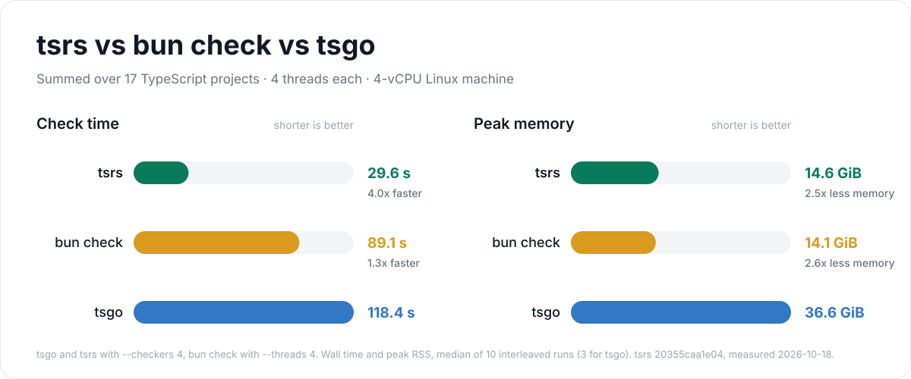

# Benchmark results

<!-- Generated by `node bench/bench.mjs render`; edit bench/release.mjs, not this file. -->

npm release binaries, measured 2026-10-26: TypeScript 7.1.0-beta (`@typescript/typescript-darwin-arm64`) and tsrs 0.20.0-ts7.1.0-beta (`@tsrs/darwin-arm64`), which ports microsoft/TypeScript@3e9236361fa9. tsrs runs in its default mode and with the fast preset (`--fast`).

Each command is `-p <project> --noEmit --incremental false --pretty false`, plus `--fast` for tsrs --fast, on an Apple M4 Pro (12 cores, 48 GB, Darwin arm64). Default-settings runs pass no `--checkers` and set no thread limit, so each compiler picks its own checker count and uses all 12 cores. Values are medians of 10 interleaved runs (5 for TypeScript), measured with Hyperfine 2.0.0. An untimed run of every command first warms the file cache and records its diagnostics. Each timed run waits until other processes use at most 1.5 CPU cores, for up to 900 s; 0 of 275 runs started after that wait expired.

The bar chart and first tables compare all three with default settings. The speed-vs-memory chart compares default tsrs with TypeScript, both with default settings. Pinned projects are in [projects.json](projects.json); see the [methodology](README.md).

<picture>
  <source media="(prefers-color-scheme: dark)" srcset="large-projects-dark.svg">
  
</picture>

## Default settings

**Wall time**

| project | TypeScript 7.1 beta | tsrs | tsrs --fast | tsrs vs TypeScript | tsrs --fast vs TypeScript |
| --- | ---: | ---: | ---: | ---: | ---: |
| t3code-server | 6.47 s | 1.70 s | 1.32 s | 3.81x faster | 4.89x faster |
| vscode | 4.99 s | 2.89 s | 2.01 s | 1.73x faster | 2.48x faster |
| mui-docs | 4.80 s | 3.04 s | 2.80 s | 1.58x faster | 1.71x faster |
| supabase-studio | 4.40 s | 2.88 s | 2.34 s | 1.53x faster | 1.88x faster |
| formbricks-web | 3.42 s | 2.26 s | 1.91 s | 1.51x faster | 1.79x faster |
| cal-diy | 2.70 s | 2.02 s | 1.80 s | 1.34x faster | 1.50x faster |
| nuxt | 0.80 s | 0.64 s | 0.58 s | 1.25x faster | 1.38x faster |
| typeorm | 0.65 s | 0.48 s | 0.46 s | 1.36x faster | 1.41x faster |
| playwright | 0.55 s | 0.22 s | 0.15 s | 2.48x faster | 3.62x faster |
| xstate-main | 0.42 s | 0.18 s | 0.13 s | 2.38x faster | 3.22x faster |
| date-fns | 0.26 s | 0.21 s | 0.21 s | 1.27x faster | 1.24x faster |

**Peak memory**

| project | TypeScript 7.1 beta | tsrs | tsrs --fast | tsrs vs TypeScript | tsrs --fast vs TypeScript |
| --- | ---: | ---: | ---: | ---: | ---: |
| t3code-server | 4.17 GiB | 1.82 GiB | 1.84 GiB | 2.30x less | 2.27x less |
| vscode | 5.51 GiB | 2.35 GiB | 1.95 GiB | 2.34x less | 2.82x less |
| mui-docs | 3.24 GiB | 1.29 GiB | 1.41 GiB | 2.51x less | 2.30x less |
| supabase-studio | 3.25 GiB | 1.38 GiB | 1.49 GiB | 2.36x less | 2.18x less |
| formbricks-web | 4.19 GiB | 1.94 GiB | 1.75 GiB | 2.16x less | 2.40x less |
| cal-diy | 3.07 GiB | 1.31 GiB | 1.58 GiB | 2.34x less | 1.95x less |
| nuxt | 930 MiB | 426 MiB | 463 MiB | 2.19x less | 2.01x less |
| typeorm | 470 MiB | 232 MiB | 242 MiB | 2.02x less | 1.94x less |
| playwright | 754 MiB | 360 MiB | 412 MiB | 2.09x less | 1.83x less |
| xstate-main | 560 MiB | 266 MiB | 247 MiB | 2.11x less | 2.26x less |
| date-fns | 266 MiB | 141 MiB | 138 MiB | 1.89x less | 1.92x less |

## Diagnostics

TypeScript, tsrs and tsrs --fast report identical diagnostics (file, position and code) for every project. Errors: t3code-server 6, vscode 371, mui-docs 0, supabase-studio 9, formbricks-web 0, cal-diy 136, nuxt 1, typeorm 31, playwright 0, xstate-main 0, date-fns 1.

date-fns reports only TS6379: a composite project cannot disable incremental compilation. This option error stops all three compilers before semantic checking, so the date-fns times cover loading, parsing and binding.
