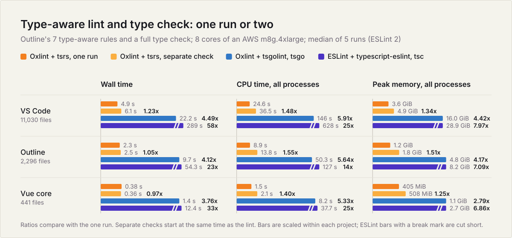
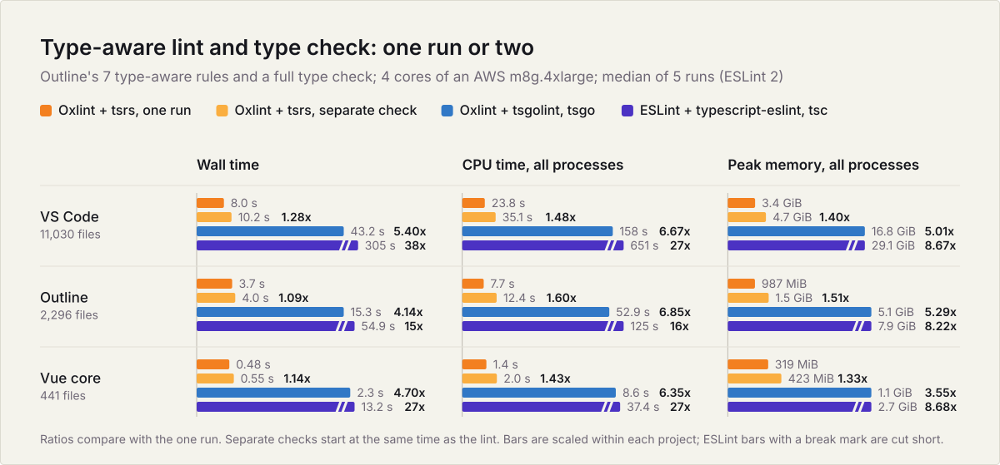

# Type-aware lint and type check: one run or two

<!-- Generated by `node bench/lint-typecheck/render.mjs`; edit render.mjs or results.json, not this file. -->

Type-aware lint and a type check usually run as separate commands, and each one parses, binds and checks the same TypeScript program. With tsrs as Oxlint's type-aware backend (0.23.0 and later), `oxlint --type-aware --type-check` lints and reports the type errors of each tsconfig program in one run, so each program is built and checked once. This compares that run with lint and `tsrs --noEmit` started together, with tsgolint plus tsgo, and with ESLint (typescript-eslint) plus tsc. In every rule set the one run's CPU time stayed near the larger of lint alone and the type check alone (4-38% above it), while the separate check pays for both. With Outline's rules, wall time depends on the core count: on 16 cores the two commands run side by side and take between 21% less and 11% more time than the one run; on 8 or 4 cores they compete for cores and take up to 28% longer.

## Setups

| setup | commands |
| --- | --- |
| Oxlint + tsrs, one run | `oxlint --type-aware --type-check` with `OXLINT_TSGOLINT_PATH=tsrs-lint` |
| Oxlint + tsrs, separate check | `oxlint --type-aware` with tsrs-lint, and `tsrs --noEmit` |
| Oxlint + tsgolint, one run | `oxlint --type-aware --type-check` with oxlint-tsgolint, which type-checks only the linted files |
| Oxlint + tsgolint, tsgo | `oxlint --type-aware` with oxlint-tsgolint, and `tsc --noEmit` from TypeScript 7.0.2 (tsgo) |
| ESLint + typescript-eslint, tsc | `eslint` with typescript-eslint, and `tsc --noEmit` from TypeScript 6.0.3 |
| Oxlint + tsrs, lint only | `oxlint --type-aware` with tsrs-lint |
| tsrs, check only | `tsrs --noEmit` |

Versions: tsrs 0.24.0-ts7.1.0-beta, oxlint 1.93.0, oxlint-tsgolint 7.0.2006, typescript 7.0.2 and 6.0.3, eslint 10.14.0, typescript-eslint 8.72.2. Machine: AWS m8g.4xlarge (16 Graviton4 vCPUs, 64 GiB), Ubuntu 24.04, Node 24.

## Outline's type-aware rules (7), 8 cores

The type-aware rules Outline enables in its own `.oxlintrc.json`, with every process pinned to 8 cores, matching the 8-vCPU runners of the tsrs CI benchmarks. The chart at the top shows this run. ESLint ran twice per project.

**CPU time**

| project | tsrs, one run | tsrs, separate check | tsgolint, one run | tsgolint + tsgo | ESLint + tsc | tsrs lint only | tsrs check only |
| --- | ---: | ---: | ---: | ---: | ---: | ---: | ---: |
| VS Code | 24.4 s | 35.7 s (1.47x more) | 117 s (4.81x more) | 139 s (5.70x more) | 656 s (27x more) | 15.6 s (1.56x less) | 18.7 s (1.31x less) |
| Outline | 8.8 s | 13.6 s (1.55x more) | 37.2 s (4.24x more) | 48.7 s (5.55x more) | 126 s (14x more) | 5.0 s (1.75x less) | 8.2 s (1.07x less) |
| Vue core | 1.5 s | 2.2 s (1.43x more) | 6.4 s (4.25x more) | 8.3 s (5.51x more) | 36.9 s (25x more) | 0.77 s (1.95x less) | 1.3 s (1.14x less) |

**Peak memory, all processes**

| project | tsrs, one run | tsrs, separate check | tsgolint, one run | tsgolint + tsgo | ESLint + tsc | tsrs lint only | tsrs check only |
| --- | ---: | ---: | ---: | ---: | ---: | ---: | ---: |
| VS Code | 3.6 GiB | 4.9 GiB (1.36x more) | 13.3 GiB (3.74x more) | 16.3 GiB (4.57x more) | 28.7 GiB (8.04x more) | 3.0 GiB (1.19x less) | 2.3 GiB (1.57x less) |
| Outline | 1.2 GiB | 1.7 GiB (1.48x more) | 3.6 GiB (3.09x more) | 4.9 GiB (4.19x more) | 8.3 GiB (7.03x more) | 897 MiB (1.34x less) | 921 MiB (1.31x less) |
| Vue core | 406 MiB | 486 MiB (1.20x more) | 1.0 GiB (2.51x more) | 1.1 GiB (2.76x more) | 2.7 GiB (6.89x more) | 319 MiB (1.27x less) | 231 MiB (1.76x less) |

**Wall time**

| project | tsrs, one run | tsrs, separate check | tsgolint, one run | tsgolint + tsgo | ESLint + tsc | tsrs lint only | tsrs check only |
| --- | ---: | ---: | ---: | ---: | ---: | ---: | ---: |
| VS Code | 4.8 s | 5.8 s (1.21x slower) | 26.1 s (5.43x slower) | 21.3 s (4.44x slower) | 293 s (61x slower) | 3.6 s (1.35x faster) | 2.5 s (1.91x faster) |
| Outline | 2.3 s | 2.3 s (same) | 10.0 s (4.35x slower) | 9.4 s (4.09x slower) | 53.6 s (23x slower) | 1.6 s (1.48x faster) | 1.5 s (1.55x faster) |
| Vue core | 0.36 s | 0.37 s (1.03x slower) | 1.5 s (4.23x slower) | 1.4 s (3.97x slower) | 12.1 s (34x slower) | 0.22 s (1.61x faster) | 0.23 s (1.58x faster) |

## Outline's type-aware rules (7), 4 cores

The same rules pinned to 4 cores, the vCPU count of a standard GitHub-hosted Linux runner for public repositories. Memory was not limited; those runners have 16 GB. ESLint ran twice per project.

**CPU time**

| project | tsrs, one run | tsrs, separate check | tsgolint, one run | tsgolint + tsgo | ESLint + tsc | tsrs lint only | tsrs check only |
| --- | ---: | ---: | ---: | ---: | ---: | ---: | ---: |
| VS Code | 23.8 s | 35.1 s (1.48x more) | 126 s (5.30x more) | 158 s (6.67x more) | 651 s (27x more) | 15.2 s (1.56x less) | 17.9 s (1.33x less) |
| Outline | 7.7 s | 12.4 s (1.60x more) | 37.3 s (4.83x more) | 52.9 s (6.85x more) | 125 s (16x more) | 4.4 s (1.75x less) | 7.1 s (1.09x less) |
| Vue core | 1.4 s | 2.0 s (1.43x more) | 6.4 s (4.70x more) | 8.6 s (6.35x more) | 37.4 s (27x more) | 0.69 s (1.96x less) | 1.2 s (1.15x less) |

**Peak memory, all processes**

| project | tsrs, one run | tsrs, separate check | tsgolint, one run | tsgolint + tsgo | ESLint + tsc | tsrs lint only | tsrs check only |
| --- | ---: | ---: | ---: | ---: | ---: | ---: | ---: |
| VS Code | 3.4 GiB | 4.7 GiB (1.40x more) | 14.0 GiB (4.17x more) | 16.8 GiB (5.01x more) | 29.1 GiB (8.67x more) | 2.8 GiB (1.18x less) | 2.1 GiB (1.57x less) |
| Outline | 987 MiB | 1.5 GiB (1.51x more) | 3.8 GiB (3.91x more) | 5.1 GiB (5.29x more) | 7.9 GiB (8.22x more) | 743 MiB (1.33x less) | 755 MiB (1.31x less) |
| Vue core | 319 MiB | 423 MiB (1.33x more) | 1.0 GiB (3.28x more) | 1.1 GiB (3.55x more) | 2.7 GiB (8.68x more) | 249 MiB (1.28x less) | 190 MiB (1.68x less) |

**Wall time**

| project | tsrs, one run | tsrs, separate check | tsgolint, one run | tsgolint + tsgo | ESLint + tsc | tsrs lint only | tsrs check only |
| --- | ---: | ---: | ---: | ---: | ---: | ---: | ---: |
| VS Code | 8.0 s | 10.2 s (1.28x slower) | 33.1 s (4.14x slower) | 43.2 s (5.40x slower) | 305 s (38x slower) | 5.5 s (1.45x faster) | 4.6 s (1.73x faster) |
| Outline | 3.7 s | 4.0 s (1.09x slower) | 11.5 s (3.11x slower) | 15.3 s (4.14x slower) | 54.9 s (15x slower) | 2.5 s (1.50x faster) | 1.9 s (1.91x faster) |
| Vue core | 0.48 s | 0.55 s (1.14x slower) | 1.8 s (3.77x slower) | 2.3 s (4.70x slower) | 13.2 s (27x slower) | 0.26 s (1.87x faster) | 0.35 s (1.38x faster) |

## Outline's type-aware rules (7), 16 cores

The same rules on all 16 cores. ESLint ran 3 times per project.

**CPU time**

| project | tsrs, one run | tsrs, separate check | tsgolint, one run | tsgolint + tsgo | ESLint + tsc | tsrs lint only | tsrs check only |
| --- | ---: | ---: | ---: | ---: | ---: | ---: | ---: |
| VS Code | 26.1 s | 38.1 s (1.46x more) | 121 s (4.62x more) | 143 s (5.48x more) | 635 s (24x more) | 15.6 s (1.67x less) | 18.9 s (1.38x less) |
| Outline | 9.9 s | 15.7 s (1.58x more) | 35.8 s (3.61x more) | 49.2 s (4.97x more) | 126 s (13x more) | 5.8 s (1.72x less) | 9.5 s (1.04x less) |
| Vue core | 1.6 s | 2.3 s (1.47x more) | 6.4 s (4.11x more) | 8.2 s (5.21x more) | 37.2 s (24x more) | 0.87 s (1.81x less) | 1.5 s (1.07x less) |

**Peak memory, all processes**

| project | tsrs, one run | tsrs, separate check | tsgolint, one run | tsgolint + tsgo | ESLint + tsc | tsrs lint only | tsrs check only |
| --- | ---: | ---: | ---: | ---: | ---: | ---: | ---: |
| VS Code | 3.8 GiB | 4.8 GiB (1.26x more) | 12.5 GiB (3.25x more) | 16.0 GiB (4.16x more) | 28.8 GiB (7.50x more) | 3.3 GiB (1.17x less) | 2.5 GiB (1.56x less) |
| Outline | 1.4 GiB | 2.1 GiB (1.48x more) | 3.8 GiB (2.62x more) | 4.9 GiB (3.42x more) | 8.2 GiB (5.70x more) | 1.1 GiB (1.35x less) | 1.1 GiB (1.29x less) |
| Vue core | 511 MiB | 635 MiB (1.24x more) | 1.1 GiB (2.12x more) | 1.2 GiB (2.32x more) | 2.7 GiB (5.43x more) | 421 MiB (1.21x less) | 270 MiB (1.89x less) |

**Wall time**

| project | tsrs, one run | tsrs, separate check | tsgolint, one run | tsgolint + tsgo | ESLint + tsc | tsrs lint only | tsrs check only |
| --- | ---: | ---: | ---: | ---: | ---: | ---: | ---: |
| VS Code | 3.7 s | 3.9 s (1.07x slower) | 24.2 s (6.54x slower) | 17.8 s (4.83x slower) | 288 s (78x slower) | 2.7 s (1.35x faster) | 1.4 s (2.66x faster) |
| Outline | 1.7 s | 1.8 s (1.11x slower) | 9.4 s (5.64x slower) | 8.6 s (5.14x slower) | 53.8 s (32x slower) | 1.4 s (1.21x faster) | 1.0 s (1.61x faster) |
| Vue core | 0.34 s | 0.27 s (1.26x faster) | 1.5 s (4.43x slower) | 1.2 s (3.66x slower) | 12.2 s (36x slower) | 0.21 s (1.60x faster) | 0.18 s (1.82x faster) |

## typescript-eslint recommended-type-checked (23), 16 cores

The 23 rules of typescript-eslint's `recommended-type-checked` preset that need type information. ESLint ran once per project.

**CPU time**

| project | tsrs, one run | tsrs, separate check | tsgolint, one run | tsgolint + tsgo | ESLint + tsc | tsrs lint only | tsrs check only |
| --- | ---: | ---: | ---: | ---: | ---: | ---: | ---: |
| VS Code | 36.4 s | 51.9 s (1.43x more) | 175 s (4.80x more) | 201 s (5.51x more) | 1124 s (31x more) | 32.3 s (1.13x less) | 19.7 s (1.85x less) |
| Outline | 10.6 s | 19.1 s (1.80x more) | 45.5 s (4.29x more) | 62.2 s (5.87x more) | 174 s (16x more) | 10.0 s (1.06x less) | 9.4 s (1.13x less) |
| Vue core | 2.1 s | 3.5 s (1.65x more) | 10.3 s (4.78x more) | 12.5 s (5.81x more) | 49.5 s (23x more) | 2.0 s (1.06x less) | 1.4 s (1.49x less) |

**Peak memory, all processes**

| project | tsrs, one run | tsrs, separate check | tsgolint, one run | tsgolint + tsgo | ESLint + tsc | tsrs lint only | tsrs check only |
| --- | ---: | ---: | ---: | ---: | ---: | ---: | ---: |
| VS Code | 4.3 GiB | 4.8 GiB (1.10x more) | 15.8 GiB (3.64x more) | 19.9 GiB (4.57x more) | 25.2 GiB (5.78x more) | 4.2 GiB (1.03x less) | 2.5 GiB (1.77x less) |
| Outline | 1.5 GiB | 2.5 GiB (1.67x more) | 4.2 GiB (2.84x more) | 6.6 GiB (4.47x more) | 7.4 GiB (4.97x more) | 1.5 GiB (1.02x less) | 1.1 GiB (1.33x less) |
| Vue core | 535 MiB | 631 MiB (1.18x more) | 1.3 GiB (2.44x more) | 1.7 GiB (3.18x more) | 2.3 GiB (4.49x more) | 532 MiB (1.01x less) | 274 MiB (1.95x less) |

**Wall time**

| project | tsrs, one run | tsrs, separate check | tsgolint, one run | tsgolint + tsgo | ESLint + tsc | tsrs lint only | tsrs check only |
| --- | ---: | ---: | ---: | ---: | ---: | ---: | ---: |
| VS Code | 6.9 s | 7.5 s (1.09x slower) | 38.8 s (5.60x slower) | 27.2 s (3.92x slower) | 604 s (87x slower) | 6.6 s (1.06x faster) | 1.4 s (4.80x faster) |
| Outline | 2.0 s | 2.2 s (1.12x slower) | 11.6 s (5.85x slower) | 8.6 s (4.33x slower) | 89.0 s (45x slower) | 1.7 s (1.16x faster) | 0.96 s (2.07x faster) |
| Vue core | 0.54 s | 0.60 s (1.11x slower) | 2.3 s (4.35x slower) | 1.6 s (3.05x slower) | 22.4 s (42x slower) | 0.53 s (1.02x faster) | 0.19 s (2.88x faster) |

## tsgolint's benchmark rules (59), 16 cores

The rule list of tsgolint's own benchmark (`benchmarks/eslint.config.mjs`). These projects don't follow most of these rules, so lint reports many more findings and takes most of the time. ESLint ran once per project.

**CPU time**

| project | tsrs, one run | tsrs, separate check | tsgolint, one run | tsgolint + tsgo | ESLint + tsc | tsrs lint only | tsrs check only |
| --- | ---: | ---: | ---: | ---: | ---: | ---: | ---: |
| VS Code | 58.0 s | 73.9 s (1.27x more) | 205 s (3.54x more) | 240 s (4.15x more) | 1371 s (24x more) | 53.8 s (1.08x less) | 20.0 s (2.89x less) |
| Outline | 11.9 s | 21.0 s (1.77x more) | 48.2 s (4.04x more) | 67.2 s (5.63x more) | 205 s (17x more) | 10.8 s (1.10x less) | 9.4 s (1.27x less) |
| Vue core | 2.4 s | 3.9 s (1.60x more) | 10.5 s (4.35x more) | 13.2 s (5.46x more) | 61.6 s (25x more) | 2.3 s (1.04x less) | 1.4 s (1.72x less) |

**Peak memory, all processes**

| project | tsrs, one run | tsrs, separate check | tsgolint, one run | tsgolint + tsgo | ESLint + tsc | tsrs lint only | tsrs check only |
| --- | ---: | ---: | ---: | ---: | ---: | ---: | ---: |
| VS Code | 4.9 GiB | 4.8 GiB (1.03x less) | 17.3 GiB (3.52x more) | 19.2 GiB (3.91x more) | 23.1 GiB (4.69x more) | 4.8 GiB (1.03x less) | 2.5 GiB (2.00x less) |
| Outline | 1.5 GiB | 2.4 GiB (1.59x more) | 4.4 GiB (2.88x more) | 7.0 GiB (4.55x more) | 7.9 GiB (5.15x more) | 1.5 GiB (1.01x less) | 1.1 GiB (1.39x less) |
| Vue core | 559 MiB | 625 MiB (1.12x more) | 1.3 GiB (2.41x more) | 1.7 GiB (3.03x more) | 2.3 GiB (4.13x more) | 559 MiB (same) | 271 MiB (2.06x less) |

**Wall time**

| project | tsrs, one run | tsrs, separate check | tsgolint, one run | tsgolint + tsgo | ESLint + tsc | tsrs lint only | tsrs check only |
| --- | ---: | ---: | ---: | ---: | ---: | ---: | ---: |
| VS Code | 21.0 s | 21.7 s (1.03x slower) | 56.7 s (2.69x slower) | 45.7 s (2.17x slower) | 834 s (40x slower) | 20.6 s (1.02x faster) | 1.5 s (14.21x faster) |
| Outline | 2.3 s | 2.4 s (1.05x slower) | 12.4 s (5.36x slower) | 8.9 s (3.82x slower) | 114 s (49x slower) | 1.9 s (1.22x faster) | 1.0 s (2.28x faster) |
| Vue core | 0.67 s | 0.74 s (1.11x slower) | 2.5 s (3.77x slower) | 1.9 s (2.83x slower) | 31.7 s (47x slower) | 0.67 s (same) | 0.18 s (3.62x faster) |

## Method

- **Projects.** Pinned release tags, dependencies installed without install scripts. That skips VS Code's postinstall, which downloads `electron.d.ts`, so setup fetches it with `node build/npm/electronTypes.ts`. Vue's tsconfig sets `composite`, which rejects `--incremental false`, so `composite` was turned off, along with `isolatedDeclarations`, which needs it. Outline's own `.oxlintrc.json` files were removed so only the rule set under test runs.
- **Files.** Every setup lints the same files: the project's source files in its tsconfig program, without declaration files. For Outline that is limited to the folders its `lint` script passes (`app`, `server`, `shared`, `plugins`). The type check covers the whole tsconfig program, except in the tsgolint one-run setup.
- **Commands.** Type checks are `-p <tsconfig> --noEmit --incremental false --pretty false`. The tsrs setups set `TSRS_FAST=1`. Oxlint runs with `--format unix` and a config that turns off its default rules and turns on the rule set's type-aware rules. ESLint uses the same rules through typescript-eslint with `parserOptions.project`, and a 32 GiB Node heap.
- **Measurement.** Each setup's processes, including the type-aware helper Oxlint starts, run in a fresh cgroup. CPU time is the cgroup's `cpu.stat` usage and peak memory its `memory.peak`, so both cover every process of the setup. Wall time ends when the last process exits. One untimed run of each setup (except ESLint) warms the file cache, then 5 timed rounds run every setup, with the order rotated each round and reversed every other round. Values are medians. The 8- and 4-core runs pin every process to the first 8 or 4 cores with `taskset` on the same 16-vCPU box, so the multi-threaded tools (tsrs, tsgo, tsgolint, Oxlint) see only that many cores and size their threads to match.
- **Findings.** The tsrs one run reports the lint findings of its separate-check setup plus the type errors of the type check, in every project and rule set but one: with the recommended-type-checked rules on Vue it reports one more `no-unsafe-argument` finding in `packages/compiler-sfc/src/style/pluginScoped.ts`, the file where TypeScript 7.1 reports circular instantiations (TS5115), likely because the full check reaches that code in a different order. tsgolint's one run reports up to 61 more lint findings than its lint-only run on VS Code. ESLint's lint findings are within 1% of Oxlint's, apart from Outline with its own rules (1 vs 0). tsrs reports the same type errors as `tsc` from TypeScript 7.1 beta (11 in VS Code, 1 in Outline, 5 in Vue). TypeScript 7.0.2 reports 0, 0 and 1, and TypeScript 6.0.3 reports 7, 0 and 0.
- **Scripts.** `setup.sh` prepares a machine, `measure.mjs` runs a rule set and `render.mjs` writes this page and the charts from `results.json`.
