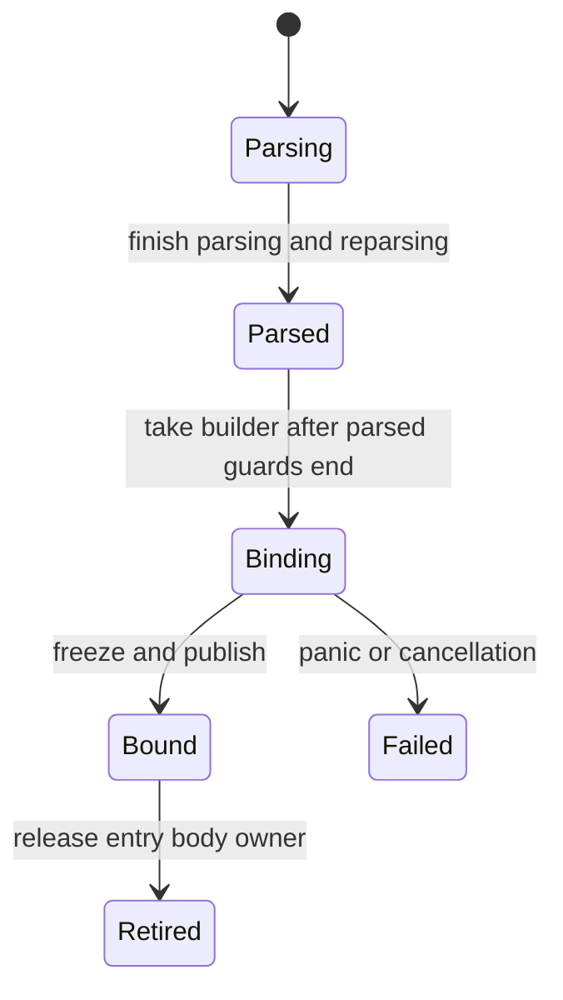

# AST SoA architecture

Proposed on 2026-10-23. This is the implementation target, not an implemented feature or a performance result.
The [migration plan](plan-ast-soa-migration.md) defines the sequence and completion gates. The earlier
[constraint study](design-ast-soa.md) and [memory-model history](safe-memory-model.md) supply the supporting evidence.

The owner's acceptance requirement is **safe Rust with no performance or memory regression**. This applies to
production migration changes as they land, including preparatory adapters, and to the completed backend. Safety
does not justify a slower or larger result. Experiments can expose regressions, but those candidates must be
reworked before landing. Confirm repeatable effects with matched, interleaved measurements rather than treating
run-to-run noise as a regression.

Inspected main for this plan: `b99d1f42`; the earlier constraint study used `ec0dba38`. The AST, parser, binder and
schema examined here are unchanged between those revisions. The reference checkout matches the Cargo pin
`3e9236361fa97a9e6c685f4833ac457ae2d8c50a`, with no tracked changes under `ts-ref/tsc`. Preserve the algorithms,
operation order and observable behavior of the
[pinned Go AST](https://github.com/microsoft/TypeScript/blob/3e9236361fa97a9e6c685f4833ac457ae2d8c50a/tsc/internal/ast/ast.go).

## Selected design

- Program retains file-version AST owners, shared with project caches and other Programs when appropriate.
- Common fields and typed payload fields use owned SoA columns. Generated views borrow an owner or guard.
- Parsing and initial binding mutate one exclusive builder. An unbound shared file uses a guarded entry until
  binding takes its builder; completed binding publishes immutable storage. This avoids duplicate flag columns.
- Lazy syntax and synthetics use additional stores with explicit owners. Published ordinary columns do not grow.
- Deferred binding uses a file-level write gate and explicit binder context, including existing symbol updates.
- Keep file reuse, old requests, early leaf-body release, checker retirement and emit-job disposal boundaries.

Separate published binding columns and persistent Program-wide arrays remain fallback designs. Reopen them with
evidence from the feasibility gates rather than mixing both approaches into the baseline.

In concrete terms, AST memory moves to ordinary heap buffers owned by file versions: `Vec` allocations for
columns, list elements and cooked text, with shared source text retained separately. Program and the project
cache retain those file owners. Nodes share buffer allocations, and edges store compact keys. A node key identifies
which store and element to borrow; it cannot read memory by itself.

| When | Who can change data | How reads remain valid |
| --- | --- | --- |
| Parsing, reparsing and initial binding | One worker has `&mut AstStoreBuilder` and, during binding, exclusive binding data. | Views borrow that builder. Copy child keys/scalars and end the borrow before recursive mutation. Rust rejects a view used across a write or buffer growth. |
| Loading an unbound shared file | A parsed-file guard controls access; binding takes the builder after those guards end. | Readers borrow the actual guard. No reference escapes into a later binding phase. |
| Checking ordinary bound syntax | Published columns are immutable; operations retain a body lease. | Views borrow the lease, which keeps the column buffers alive. |
| Deferred binding and late syntax | A session owns a new fragment builder and the file's binding write guard. | Published syntax remains readable. Shared symbols/annotations use binding guards; recursion uses the active session. |

The safe ownership argument is independent of the physical choice between full payload columns and a hybrid.
The performance and memory requirement still needs production evidence; this table establishes no speed or RSS
claim. Changes to Rust callers are an explicit API contract to settle before the broad consumer migration;
the intended TypeScript behavior and JS/LSP protocols remain unchanged.

Two owner questions were raised during the follow-up and have no recorded answer yet:

- May public Rust AST callers move to explicit owner/context APIs? The implementation target assumes this;
  preserving an owner-free pointer-style public interface would require revisiting that interface before M2.
- If full payload columns regress, may common columns plus typed payload records satisfy the SoA goal?
  The hybrid remains a proposed measured fallback, rather than an approved change to the layout requirement.

Neither question changes the safe-Rust/no-regression requirement. Continue the independent audits and
measurements while these contracts are pending.

## Identities and layout

| Term | Meaning |
| --- | --- |
| `AstStore` | One owned set of AST columns, usually for one source-file version. Lazy fragments and synthetic syntax can have additional stores. |
| `AstStoreId` | Stable identity of an AST store, preserved when Programs share it. |
| `NodeIndex` | An opaque table/element address within its store; not allocation order. |
| `NodeKey` | `AstStoreId` plus `NodeIndex`, identifying a node across stores. |
| `ListKey` | A distinct store-qualified identity for a node/modifier list. |
| `FileAstOwner` | Retains a file version, its source information, base store and file-owned extensions. |
| `AstStoreLease` | Retains immutable column storage during an operation. Views borrow the lease. |
| `AstRead` / `AstWriter` | Explicit read context / exclusive mutable access to one unpublished store. |
| `BindingData` / `BindingLease` | One file version's owned binding namespace and its retaining handle; base syntax and later fragments use the same symbol/flow identities. |

These shapes illustrate the grouped-column prototype. The full schema and binding integration remain pending:

```rust
struct NodeKey { store: AstStoreId, index: NodeIndex }
struct ListKey { store: AstStoreId, index: ListIndex }

struct CommonColumns {
    kinds: Vec<Kind>, // Empty for a table whose payload fixes its kind.
    flags: Vec<NodeFlags>,
    ranges: Vec<TextRange>,
    parents: Vec<Option<StoredNodeKey>>, // Four-byte local/foreign edges.
    semantic_ids: Vec<AtomicU32>,
    comma_markers: Vec<u64>,
}

struct BinaryExpressionColumns {
    common: CommonColumns,
    lefts: Vec<StoredNodeKey>,
    operators: Vec<StoredNodeKey>,
    rights: Vec<StoredNodeKey>,
    // Other schema fields retain their existing optionality and rarity policy.
}
```

Use private fields and checked constructors. For the correctness probe, start with `AstStoreId` and indexes backed by `NonZeroU32`, with
one-based encoded indexes. Assert that `NodeKey`, `Option<NodeKey>` and corresponding list keys occupy eight
bytes in the real implementation. Allocate process-unique store IDs with a separate checked counter; never
reuse or wrap an ID. This numeric counter owns no AST data. Stable node keys are never reused. A speculative
allocation can reuse a private slot only when rejected handles cannot escape its scope; commit/retention makes
its key stable before exposing it. The experimental `AstScope` storage API implements that distinction, with
private raw-key construction. Owned parsing returns ordinary keys outside speculation; shared lookahead now
uses scoped handles and reclaims unretained allocations. Explicit ordinary-key snapshots retain allocations.
Complete grammar adoption and measurement remain open in the [rollback audit](ast-parser-rollback-audit.md).
Check bounds, integer conversions and capacity exhaustion explicitly.

The eight-byte form is not an accepted production layout yet. Compact four-byte edges, table metadata and lookup
cost are early feasibility work under the no-regression requirement. A wider layout can ship only if complete
compiler measurements show no performance or memory regression after counting all compensating layout changes.

Semantic `NodeId`, symbol/type IDs and API wire indexes keep their existing meanings and assignment order.
Storage-key order must not reach diagnostics, semantic ordering or codec sorting. The codec can emit multiple
wire entries for one node. A storage index does not replace any of those IDs.

Payload type is independent of `Kind`: the two handwritten flow payloads both use `Kind::Unknown`. Preserve a
safe discriminator and checked typed-table selection, including canonical token payload rules. Avoid one inline
enum sized for the largest payload. Allocate boxed column groups only for payload types present in a store.
Each group owns common and typed columns. A private node address uses 11 bits for the present table and 20 for
its element, within the existing 31-bit local encoding. Overflow creates another table of the same payload.
Checked one-based encoding reserves the foreign high bit and excludes the last element of the last table.
No stable keys are reused, and physical address order must not affect semantic order.

The builder alone retains the tag-to-latest-table lookup. Published keys select a table directly; its safe enum
variant identifies the payload, without per-node tags/indexes. Fixed-kind tables also omit per-node kinds.
The current representative implementation uses 20 common column bytes plus one comma-marker bit for a fixed
kind, or 22 bytes plus one bit for variable kinds, before capacities/metadata. Rare optional construction fields
use sorted `(element, value)` entries with binary-search reads and no slot for absent values. This is a tested
prototype, not a production layout accepted by performance/RSS measurements. Actual table/capacity costs are in
the [progress log](ast-soa-progress.md).

Generate allocation, views, setters, base accessors, traversal, clone/update and invariant checks from
[gen-ast.ts](../tools/gen-ast/gen-ast.ts). Classify fields by construction/reparsing, loader finalization, initial
binding, deferred binding/cache/atomic mutation, and synthetic construction. The codec generator uses the same
contract. A typed view such as `BinaryExpressionView<'a>` reads columns; there is no fake physical payload object.

Allocation completes all affected common/payload/list columns before exposing a key. Panic discards the
unpublished builder or restores consistent lengths. Keep invariants private. A common-SoA/typed-payload-record
hybrid is a measured fallback if full payload columns cost too much; views hide that physical choice.

## Owners and access

```text
project cache / Program / standalone file handle
    -> FileAstOwner for a particular file version
         -> immutable SourceFileInfo and owned source text
         -> base entry: parsed builder OR bound immutable store
         -> binding owner: guarded symbol/flow/annotation data; retains named syntax
         -> file-owned lazy fragments and token caches

Program loading -> owner for loading-generated syntax
checker/result  -> owner for checker-generated syntax
emit/edit job   -> owner for transformed syntax

AstRead -> explicit access to these owners
        -> AstStoreLease -> borrowed node/payload/text/list views
```

Storage APIs live in `tsrs_ast`; the AST crate does not depend on `tsrs_compiler`. Program/project types compose
owners. Parser-only, config/JSON, transpile and oracle callers own standalone equivalents.

An explicit `AstDirectory` resolves store IDs through weak registrations. Actual file/job/result owners hold
strong references. Share the directory at the project/compilation-session boundary, before parsing begins, so
file-owned late stores become visible to all Programs retaining that version. Clean up expired registrations.
An imported owner also exposes its original directory: on a resolution-cache miss, the read context can search
that retained directory. Importing only current registrations would miss future lazy fragments and is invalid.

Lookup validates that the operation retains, or can acquire, the relevant file/job owner. A key from an unrelated
Program cannot silently resolve merely because its store exists. Cache acquired leases for local traversal;
avoid a lock/hash/refcount operation for every field access. The probe must exercise imported owners and a later
lazy publication observed by two Programs.

Each registration records its root file/job owner identity alongside the weak store entry. `AstRead` gets its
permitted root owners from Program or explicit result/job inputs and checks that set before acquiring a store.
File paths and positions in a Program's file list are not owner identities.

```rust
let lease = reads.lease(key)?; // retains storage, validates owner and state
let node = lease.node(key)?;  // NodeView<'_> borrows lease
let kind = node.kind();       // scalar copy
```

A direct `AstRead::node(key)` form is valid only if that context already retains the store. Returning a view
through a temporary local `Arc` or dropped directory/cache guard is invalid. Distinguish wrong-owner, retired,
failed, invalid-index and wrong-payload errors; internal invariant violations may assert after validation.
Keys have no `Deref`. There is no thread-local current Program or owner-free runtime text access.

Split immutable file identity/options/text from the releasable syntax body. Finalize loader-written metadata
under the parsed-file write guard. Preserve SourceFile-as-node identity; metadata access must not require a
retired syntax body. Source text is independently owned and can be shared with extensions and scanner input.
Identity/text can be immutable from parsing onward; loader-written metadata remains a guarded draft until
finalization, then freezes into the durable file information. Do not mutate an already shared immutable `Arc`.
Diagnostic lists must live outside the source identity/text information retained by their locations. Attaching
a diagnostic cannot create a strong edge back to the file owner that stores it, or keep a syntax body alive.

Durable `SourceFileId` identifies one metadata version independently of AST store keys and semantic node IDs.
Cache hits preserve it; SourceFile copies receive a fresh identity even when filename and text are equal.
Mapped outputs share an immutable metadata bundle with indexed canonical/supplemental links. The bundle owns
source information, mappings and directives, without retaining bodies. A mapped copy shares the original
mapping/link data while retaining its current source metadata, matching the reference's selective copy.
Following a metadata link requires a retaining bundle handle; following syntax additionally requires the
corresponding body owner. The [SourceFile audit](ast-source-file-ownership-audit.md#isolated-bundle-implementation)
records the isolated implementation and its remaining production-integration proof.

Program owns file entries rather than a permanent strong reference to every body. Under the existing leaf-release
proof, an entry can remove its strong body owner. Existing leases preserve that body; future acquisitions fail
as retired. Requests, results and codec tables retain body leases when their keys must remain usable. Retaining
metadata alone is insufficient. A whole-Program lease across checking would defeat early leaf release.

File-owned extensions retain source text/info and qualified parent keys, without a strong back edge to the file
owner that owns their cache. An operation following an external edge retains the target's owner. Longer-lived
caches/results retain dependency owners at their boundary. Internal keys do not retain an `Arc` per edge.

The old manually freed `'static` Program interface is a separate hole. New AST views borrow real leases, and
public AST results retain their owners independently of that old reference. AST completion does not establish
soundness of remaining arena-backed type/symbol/Program interfaces.

## Parse, load and initial binding

The file entry uses a mutex for state/unpublished storage and a condition variable for waiters. No algorithm
runs under a directory-wide lock.



1. **Parsing:** one worker owns `FileAstBuilder`. Construction, parent/range changes and reparsing use `&mut`.
   Scanner text borrows caller-owned input; avoid a self-referential parser or static lifetime extension.
2. **Parsed:** park the builder in the file entry. Loading acquires `ParsedAstGuard<'_>` for reads and an
   exclusive parsed write guard for finalization. Owners/keys may be copied; references borrow the guard.
3. **Binding:** wait for parsed guards to end, move the builder into `BindSession`, set Binding, then release
   the entry mutex. The session alone mutates columns. Other operations wait; binder recursion uses its context
   directly. Bind at the existing point/order, including reverse file order in single-threaded Program binding.
4. **Bound:** consume the builder into immutable columns, install the strong body owner, mark Bound and notify
   waiters. Acquiring a bound lease clones the body owner under a short lock. Scalar reads then need no lock.
   Reused bound files skip this transition.
5. **Failed:** an RAII session guard marks failure and wakes waiters after panic/cancellation. Discard the
   unpublished AST and evict the failed cache entry. Do not retry a partial session or rewind semantic counters.

Release parsed guards before callbacks that can bind; recursive helpers take the current view/context instead
of reacquiring the entry. Checker and bound-codec entry points require `BoundAstRead`. A parsed guard is not
proof of completed binding. The loader/cache migration must demonstrate every real transition obeys these rules.
Standalone parse-only callers may retain the guarded unbound owner without constructing Program.
Blocking waits must cooperate with the existing run-slot/worker-pool protocol, rather than holding a compute
permit while waiting for the task that must make progress. Include a bounded-worker starvation case in the probe.

## Mutation and factory API

Mutation authority comes from `&mut AstWriter`, not the key. A setter validates that its target belongs to its
store. Values such as parents can point into another readable store. Generated setters change from
`node.set_flags(flags)` to `writer.set_flags(node, flags)`.

```rust
// Pseudocode for nodes local to one builder.
let (left, right) = {
    let binary = ast.binary(node);
    (binary.left(), binary.right())
}; // Only copied indexes survive.
bind_node(&mut ast, left);
bind_node(&mut ast, right);
ast.set_flags(node, computed_flags);
```

Rust prevents retaining a view in use while mutation/growth occurs. Copy a few keys/scalars and borrow briefly;
avoid cloning whole nodes/lists. Visitors release child borrows before mutating callbacks. Stable list ranges
plus indexed reads can preserve traversal order without copying whole lists.

Separate cloneable factory configuration/hooks from the exclusive, non-cloneable writer. Pass the writer to
callbacks. Sequence nested mutable constructors into temporaries in Go evaluation order. A checked thread-local
`RefCell` is an optional compatibility tool only where necessary; guards end before reentrant callbacks and
checks remain enabled in release builds. `finish(self)` consumes the builder. Standard trait bounds determine
`Send`/`Sync`; no unconditional implementations or unchecked cells in the new AST storage.

List records retain identity, positions, trailing commas and ranges into owned key buffers. List views borrow
storage; published buffers never grow. Preserve nil/empty distinctions where the current behavior needs them.
Source text ranges are validated UTF-8 byte ranges. Escaped/cooked/raw/synthetic text retains its current meaning
and owned buffers. Replace the raw source-text pointer registry; do not bundle global identifier interning.

Start with append-only node identities during speculation. Preserve parser/scanner rollback and reparser clone
mappings. Reclaim private tails only with a transaction proving no surviving keys or preexisting-row writes
depend on them. Do not reset semantic counters. Measure append-only overhead and account for existing checkpoint
reclamation before production cutover.

The [rollback audit](ast-parser-rollback-audit.md) now records the concrete boundaries, including outward
JSDoc state, retained top-level-await reparses and lazy declaration-list discard. The implemented owned snapshot
still retains abandoned allocations. Scoped temporary handles are a feasibility candidate for reclaiming private
slots while preserving every externally usable key; adopting them would require changing the current plain-key
speculation contract explicitly. Two standalone type probes cover callback scoping and shared recursive grammar,
but neither changes production storage. Buffer capacity retained after truncation is a separate unresolved cost,
especially for lazy lists. Do not describe either issue as solved by scanner-state rollback.

The implemented lexical context uses one scanner/regexp algorithm parameterized by text ownership. The legacy
policy returns arena strings; `OwnedScanner<'src>` borrows source slices and owns cooked values and snapshots.
`OwnedParser<'src>` borrows a caller-retained `Arc<str>` and gives its builder an Arc clone, avoiding a
self-referential parser. A checked source range can cross scanning; cooked text must be independently retained
until construction copies it into the store. Short scanner/store borrows end before recursive mutation.
Shared lexical grammar preserves scanning/diagnostic/construction order. The owned context records a source
descriptor before taking token text; a cooked value transfers its String allocation out of the scanner without
cloning. Saved speculation snapshots remain independent. This is the first real owned grammar slice, not a
complete source-file parser. Snapshot/cache clones and copying cooked values into store buffers are prototype
costs requiring measurement; scanner parity alone does not accept them.

## Late syntax and shared binding mutation

JSDoc fragments and LS cache tokens are built privately, parented, frozen, then published through file-owned
synchronized caches. Preserve token cache identity by parent/range and kind checks. Initially an insertion can
own a small token store; measure and batch publication groups if per-token store metadata is material. Shared
maps live inside standard locks. Do not lend permanent slices into a growable cache vector.

Keep the private owner alive while installing its directory registration and strong cache owner, then mark the
slot Ready. Failures wake waiters and expose no partial entry. Initialization primitives require a proof of
non-reentry; deferred members explicitly cannot use a recursive same-slot `OnceLock::get_or_init`.

### Deferred member protocol

The binder merges flags, declarations and value declarations on existing symbols while filling members/exports.
Protecting only the list or its map is insufficient. The conservative baseline is one deferred-binding write gate
per file, a standard `RwLock<BindingData>` owning every shared field reachable by these writes.

Use **one binding namespace per file version**, independent of its syntax-store IDs. A later syntax fragment
gets a new syntax-store identity, but its declaration-symbol and identifier-flow annotations resolve through the
same file binding owner. A same-numbered symbol or flow index from another file is invalid. Keep compact local
binding indexes in columns and qualify them with the explicit binding-owner identity at access boundaries;
do not infer the binding owner from a declaration or a thread-local current file.

During initial binding, `BindSession::parts_mut` lends disjoint exclusive access to the syntax builder and
binding data. A late binding session owns a private fragment builder plus the file's binding write guard.
It can annotate that fragment with existing symbols/flows and update existing binding records. It cannot obtain
mutable access to already published syntax. Any annotation that the completed callee audit finds writable on an
existing published node must live in the guarded binding columns, with every reader moved too. Construction-only
annotations can freeze with syntax. The field audit decides this split; the current representative setters do
not establish that every annotation is construction-only.

The binding owner retains the base syntax and every published fragment named by its declarations, flow-associated
nodes and tables. Syntax holds numeric binding identities, with no strong back edge. Results retaining binding
keys retain a binding lease; a bare syntax lease alone does not retain the mutable binding data. Publication must
validate and retain dependencies before exposing completed binding updates. Supporting cross-file declarations
would require explicitly retained dependencies and a revised locality/lock proof, rather than merely accepting a
foreign key. Private unfinished fragments remain owned by their active session until commit or failure.

Move affected tables and symbol fields into the protected owned data, preserving stable symbol identity. Both
readers and writers use binding views, including readers that already cached a symbol key. The stable symbol
shell and unrelated semantic storage can remain legacy. If the field set cannot be isolated, expand this adjacent
change before cutover. An external mutex convention around unchecked cells is not the target.

The gate's audit also includes saved flow nodes. The flow condition/mutation/call/switch helpers and
`add_antecedent` set `Referenced`/`Shared` on antecedents, but the current parser explicitly rejects flow-producing
syntax from lazy lists. Preserve its exclusions and finish the reachability proof. If any eligible late path
writes published flows, protect the actual data/readers or implement a measured safe atomic representation.
Likewise a checker symbol sharing binder `SymbolData` must retain and read its data owner through that owner's
protection. See the [deferred-binding audit](ast-deferred-binding-audit.md); it remains open.

Keep the existing logical states distinct: Pending before the binder reaches the list, Deferred with saved
binding context, ParseOnly when the binder never reached it (current `UNBOUND`), Building, Ready and Failed.
ParseOnly forcing must not invent a bind step. During initial binding, inline forcing uses `BindSession`'s existing
exclusive authority instead of acquiring a gate on a published file. The following protocol covers forcing after
initial publication. Only the exclusive active session can observe Building records and their private partial
nodes; public readers remain behind the file gate. No thread-local ownership assumption is needed.

1. Completed lists return immutable syntax leases. To start a pending list, acquire the file write gate **before
   claiming the list**. Otherwise two threads could claim different lists and wait on each other during recursion.
2. Create `LazyBindContext` with that write authority, saved binder state and a private fragment builder. Parse
   and make parsed keys available inside this context before binding, as the current implementation does.
   Skip binding for a ParseOnly list.
3. Recursive forcing uses the same context: read its in-progress list or force another list in this file without
   reacquiring the public gate. No other thread can own another in-progress list in this file.
4. Public binding readers use short read guards and copy needed data. Drop guards before anything that can force;
   do not invoke forcing callbacks under a read guard. Forcing requires a mutable read context, and borrowed
   binding views cannot remain in use across it. Immutable base syntax needs no binding guard.
5. Complete binding, freeze/register the fragment and install its strong owner. Mark Ready under write authority,
   then release the gate. Readers of shared binding fields cannot observe partial updates.
6. On panic/cancellation, an RAII guard marks the list and affected binding owner Failed and wakes waiters.
   In-place shared changes are not retried or rolled back. Semantic operations reject that failed version and
   evict/rebuild it explicitly. Propagate poisoning/failure; do not recover partial bindings silently.

Binding under this gate must stay file-local. It cannot call cross-file semantic resolution or acquire another
file's deferred gate. Prove this for nested lists and declaration merges; if it does not hold, revise the protocol
before cutover. A mutex alone does not prove deadlock freedom.

This serializes late parsing/binding within one file, while different files and immutable syntax reads remain
independent. Measure contention and preserve deferred timing, saved context, diagnostics/symbol-count behavior
and the rule not to splice late containers into the published file chain. All existing lazy modes must remain
reference-identical. Finer gates/publication are follow-ups after this baseline is correct and measured.
Gate waits follow the same worker/run-slot blocking protocol as initial publication waits.

The isolated implementation now provides `FileBindingContext::force_list`, `LazyBindSession` recursion,
initial parse-now handling and result leases. `BindingLease::read`/`write` remain low-level probe primitives:
acquiring a write guard while the same operation retains a read guard can deadlock. Production integration must
route forcing through the explicit mutable context and same-session recursive path. The complete production
parser/binder audit and migration remain open; passing protocol tests alone does not close that gate.

Initial publication validates all binding and syntax dependencies together, after retaining private fragments.
Later writes journal changed node references/annotation targets and newly retained fragments; write completion
validates those dependencies before readers can observe the result. Lazy-list bookkeeping and write journals
allocate only when needed. A queue of new Pending lists is drained once at publication/commit, avoiding repeated
full-file scans. Finished lists take a short read guard and return immutable retained syntax. These metadata,
allocation and lookup choices still require complete workload measurements.

## Synthetic stores and adjacent references

| Producer | Owner | Lifetime |
| --- | --- | --- |
| File-loader synthetic imports | Program-loading storage | Program data retaining the imports; source parents resolve through file owners. |
| Checker synthetic syntax | Checker or result storage | Every dependent cache/type/symbol/result retains the required storage. |
| Emit/LS transformed syntax | Emit/edit job | Through printing/serialization, with explicit retention for escaping results. |
| JSDoc, lazy members, cached tokens | File-version extension storage | Shared across Programs retaining that version. |

A synthetic writer may read source nodes and reference them, but cannot mutate source targets. Audit late setters:
if a path changes a reused source child, use a clone or explicit job-local override with the same observable
identity behavior. Keeping all synthetics until Program drop would lose existing checker/emit reclamation.

Symbols, flow nodes, diagnostics, checker links, printer maps, codec tables and LS caches change their node/list
fields to keys even if their own allocators remain legacy. Replace old packed pointer-bit encodings with typed,
sized safe representations; never truncate an eight-byte key into an old four-byte word. Synthetic payloads that
refer to checker types need an explicit checker/result lifetime instead of a detached static `dyn Any` value.

New AST columns contain no raw node pointers, `P<Node>`, `P<SourceFile>`, `P<NodeList>`, or detached runtime strings/
slices. String literals may be static. Remaining legacy symbol/flow/type references are an explicit boundary,
whose APIs and reclamation are not declared sound by completing AST storage.

During transition, the leased file body also retains the legacy allocation owner for any referenced binder
symbols, flow data and diagnostics; retaining only the node columns would shorten those dependencies' lifetimes.
Synthetic result owners similarly retain the required semantic storage. Retention must not create a cycle through
the checker pool and Program; split result storage from the pool owner, or serialize owned result data before
releasing the checker. Region retention still does not make the remaining legacy APIs sound or justify recycling
objects referenced by a live result.

## Costs and reopening criteria

Current common node headers occupy 24 bytes and compressed edges four bytes. An illustrative split totals 27
bytes before payloads with a four-byte parent; the proposed eight-byte optional parent makes that 31 bytes.
Edge arrays widen too. Safe descriptors, capacities, atomics, directories and table headers all count.

The schema has 192 node types plus two handwritten flow payloads. One empty `Vec` per schema type already costs
4,608 bytes per file on a 64-bit target. Sparse present-table allocation is mandatory in the baseline. Measure
tiny files, reserved capacities, node/list/text bytes, token-store metadata, directory/lease operations, lazy
binding contention, semantic-ID false sharing and retained bodies across repeated updates.

Measure these alternatives separately if necessary: compact local edges with checked external-key tables;
common SoA plus typed payload records; grouping small files into immutable chunks; faster directory routing;
finer deferred-binding gates; safe private-tail rollback. Preserve identity and lifetime rules in comparisons.
The [compact-AST study](mem-compact-ast-sizing.md) did not implement this design. Current measurement policy
supersedes old percentage thresholds; sound ownership is the new requirement for revisiting layout.

For this migration, the owner's no-regression requirement is stricter than the repository's general rule allowing
catalog tradeoffs. Check each workload and supported measured checker configuration: an improvement elsewhere
does not cancel a repeatable slowdown, instruction increase, higher peak RSS or worse retained-memory behavior.
Compact handles, sparse metadata, allocation grouping, speculation reclamation and lease overhead must be addressed
before a regressing production change lands, rather than deferred until after cutover.

The replacement cannot finish with static AST views, ambient allocation routing, per-node `Arc`s, unchecked
shared cells, disabled laziness, eager binding that changes IDs, or a permanent duplicate pointer/SoA tree.
