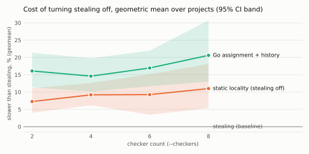
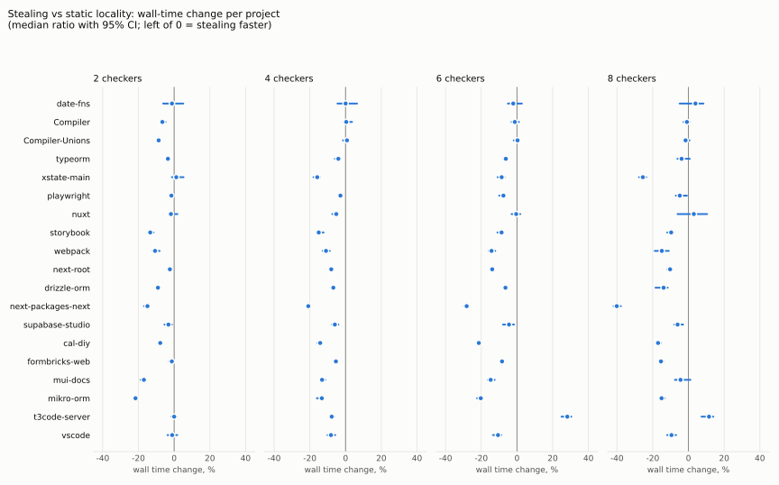
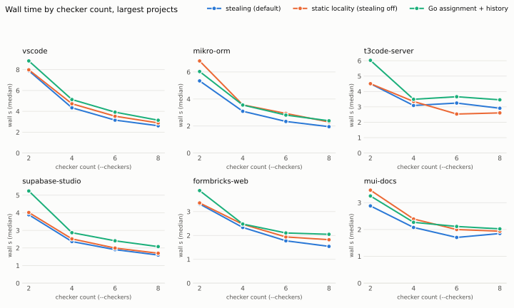

# perf-stealing-benefit: what checker work stealing is worth in wall time

Question (2026-10-19): would removing work stealing, to bring tsrs's scheduling closer to tsgo, cost wall time on
realistic workloads, and how much? This note measures the default (stealing) against the two static modes it could be
replaced by, on the 19 projects of `bench/projects.json` at 2, 4, 6 and 8 checkers.

## Short answer

Stealing makes the type check faster on most real projects, and the difference is well outside run-to-run noise.

| checkers | stealing vs static locality (geomean over 19 projects) | summed wall time, stealing / locality | projects faster / slower (95% CI excludes 0) |
| ---: | ---: | ---: | ---: |
| 2 | -6.8% [-10.0, -3.9] | 38.7 s / 41.9 s (-7.7%) | 14 / 0 |
| 4 | -8.4% [-11.2, -5.8] | 24.4 s / 27.0 s (-9.7%) | 16 / 0 |
| 6 | -8.5% [-13.1, -3.3] | 20.0 s / 21.8 s (-8.3%) | 14 / 1 |
| 8 | -9.9% [-15.3, -5.1] | 17.7 s / 19.4 s (-9.1%) | 12 / 1 |

Put the other way: turning stealing off and keeping the static locality assignment makes the check 7-11% slower on
average (geomean), with per-project costs up to 67% (next-packages-next at 8 checkers: 0.54 s to 0.90 s). Going all
the way to tsgo's assignment and check history (`go`) makes it 15-21% slower.

The one project where stealing loses clearly is t3code-server, at 6 checkers (+28%) and 8 (+11.5%): its stealing
time goes *up* from 4 to 6 checkers. That is a scheduling problem specific to stealing on that project, not noise
(all 20 stealing runs at 6 checkers are slower than all 20 locality runs); see "Exceptions".

<picture>
  <source media="(prefers-color-scheme: dark)" srcset="perf-stealing-benefit/aggregate-dark.svg">
  
</picture>

## What was compared

Three arms, all with the same binary and flags (`-p <project> --noEmit --incremental false --pretty false --checkers
N`):

| arm | how | what it is |
| --- | --- | --- |
| `steal` | no assignment named (the default) | locality assignment, then dynamic stealing during the type-check pass |
| `locality` | `TSRS_CHECKER_ASSIGNMENT=locality` | the same locality assignment, no stealing: what removing stealing alone would leave |
| `go` | `TSRS_CHECKER_ASSIGNMENT=go` | tsgo's file assignment and tsgo's check history: the fully tsgo-compatible mode |

Naming any assignment turns off more than the queue stealing itself (`stealing_enabled` in checkerpool.rs gates all
of it): the heavy-files-first start order (`heavy_files_first`), split checking of heavy declaration files
(`plan_splits`) and the sticky-steal module affinity. So the `locality` arm is "remove stealing and what depends on
it", which is the change under consideration. Separating the parts was not attempted here.

Output: `steal` and `locality` printed byte-identical stdout (diagnostics) in every one of the 76 project x checker
cells, across all 20 runs each. `go` differed in three cells, as expected from tsgo's history: nuxt printed 3 errors
instead of 4 at 2 checkers, and drizzle-orm 10,845 instead of 10,846 at 2 and 6 checkers (the cases of
notes/fix-history-dependent-diagnostics.md and notes/perf-order-independence.md). A tsgo-compatible mode therefore
also means checker-count-dependent output.

## Method

- Machine: Boxy dev container on an AWS host (Intel Xeon Platinum 8375C @ 2.90 GHz, 32 cores / 64 threads, host ~93%
  idle), container limited to 8 CPUs by a CFS quota. Every run was pinned with `taskset -c 8-15`: eight distinct
  physical cores, no SMT siblings, so a run never competes with itself for a core or hits the quota (the default
  8-CPU quota over 64 schedulable CPUs throttles bursty parallel work). Checker counts go up to 8, the CPUs available.
- Binary: tsrs at 620b4ac2 (`main`, 0.18.0), `cargo build --release` (fat LTO, no PGO; the published `dist` build is
  PGO + BOLT, so absolute times here are slower than bench/RESULTS.md, but all arms share the binary).
- Projects: `bench/projects.json` (19 projects), cloned and installed by `bench/run.py --setup-only` (Node 24, the
  repo's `.node-version`). Error counts match bench/RESULTS.md (vscode 371, webpack 840, drizzle-orm 10,846, ...).
- Runs: 20 rounds per project. A round runs all 12 cells (4 checker counts x 3 arms) once, in a fresh random order,
  so drift and background noise land on every arm alike. One untimed warm-up per project. 4,560 timed runs in total,
  about 100 minutes.
- Statistic: wall time of the whole process (`time.perf_counter` around `subprocess.run`). Per cell, the median of 20
  runs. Stealing's change is median(steal) / median(other) - 1, with a 95% percentile bootstrap interval (4,000
  resamples of each arm's runs). The cross-project geomean's interval resamples projects and runs together (2,000
  resamples). "Summed" adds the per-project medians, which weights the large projects, as bench/RESULTS.md does.

## Per project

<picture>
  <source media="(prefers-color-scheme: dark)" srcset="perf-stealing-benefit/per-project-dark.svg">
  
</picture>

Stealing's wall-time change against `locality` (negative: stealing faster), median ratio and 95% CI:

| project | 2 checkers | 4 checkers | 6 checkers | 8 checkers |
| --- | ---: | ---: | ---: | ---: |
| vscode | -1.1% [-3.7, +1.7] | -8.2% [-10.2, -5.8] | -10.6% [-13.4, -8.8] | -9.5% [-11.9, -6.9] |
| t3code-server | -0.0% [-1.6, +1.4] | -7.8% [-8.7, -6.4] | +28.2% [+24.9, +30.4] | +11.5% [+7.3, +13.9] |
| mikro-orm | -21.6% [-22.2, -20.8] | -13.3% [-16.1, -12.2] | -20.3% [-22.4, -19.4] | -15.0% [-15.7, -13.3] |
| mui-docs | -16.9% [-18.8, -16.2] | -13.2% [-14.0, -11.4] | -14.7% [-16.3, -12.5] | -4.4% [-7.5, +1.1] |
| formbricks-web | -1.3% [-2.8, -0.7] | -5.4% [-6.2, -4.2] | -8.4% [-9.1, -7.3] | -15.4% [-16.0, -13.9] |
| cal-diy | -7.8% [-8.5, -7.1] | -14.2% [-15.8, -13.4] | -21.4% [-22.3, -20.8] | -17.0% [-18.1, -15.4] |
| supabase-studio | -3.2% [-5.5, -1.3] | -6.0% [-7.6, -4.0] | -4.5% [-7.8, -1.7] | -6.1% [-7.9, -3.0] |
| next-packages-next | -14.9% [-16.9, -13.9] | -20.9% [-21.9, -20.0] | -28.2% [-29.7, -27.4] | -40.1% [-41.9, -37.8] |
| drizzle-orm | -9.1% [-9.7, -8.3] | -6.9% [-7.9, -6.0] | -6.5% [-7.7, -5.5] | -13.9% [-18.4, -11.6] |
| next-root | -2.4% [-3.7, -1.7] | -8.0% [-9.2, -7.2] | -13.9% [-14.9, -13.0] | -10.3% [-11.8, -9.0] |
| webpack | -10.7% [-12.0, -8.1] | -11.0% [-12.8, -8.8] | -14.3% [-15.8, -12.2] | -14.9% [-18.8, -11.0] |
| storybook | -13.4% [-14.3, -11.5] | -15.0% [-16.0, -12.4] | -8.6% [-11.0, -7.5] | -9.6% [-11.9, -8.3] |
| nuxt | -1.8% [-3.0, +1.8] | -5.2% [-7.4, -4.2] | -0.4% [-3.0, +1.9] | +3.0% [-6.1, +10.5] |
| playwright | -1.5% [-2.6, -0.8] | -2.9% [-4.0, -1.5] | -7.6% [-10.0, -6.5] | -4.8% [-7.1, -0.8] |
| xstate-main | +1.2% [-1.3, +5.3] | -15.9% [-18.0, -14.5] | -8.6% [-10.9, -7.0] | -25.5% [-27.7, -23.6] |
| typeorm | -3.5% [-4.3, -2.5] | -4.0% [-6.0, -2.7] | -6.3% [-7.5, -5.1] | -3.8% [-6.2, +0.8] |
| Compiler-Unions | -8.7% [-9.6, -8.2] | +0.8% [-1.5, +2.0] | +0.3% [-1.8, +1.2] | -1.6% [-2.4, +0.6] |
| Compiler | -6.6% [-7.6, -4.8] | +0.4% [-0.9, +3.6] | -1.2% [-3.1, +1.1] | -0.8% [-2.8, +0.6] |
| date-fns | -1.2% [-6.2, +5.1] | +0.0% [-4.6, +6.4] | -2.1% [-5.1, +2.8] | +3.9% [-4.9, +8.4] |

Rows are sorted by `locality` wall time at 8 checkers, largest first. Median wall seconds, steal / locality / go:

| project | 2 checkers | 4 checkers | 6 checkers | 8 checkers |
| --- | ---: | ---: | ---: | ---: |
| vscode | 7.90 / 7.98 / 8.84 | 4.34 / 4.73 / 5.13 | 3.15 / 3.53 / 3.92 | 2.61 / 2.89 / 3.14 |
| t3code-server | 4.51 / 4.51 / 6.02 | 3.09 / 3.35 / 3.49 | 3.25 / 2.53 / 3.66 | 2.91 / 2.61 / 3.46 |
| mikro-orm | 5.34 / 6.82 / 6.03 | 3.09 / 3.57 / 3.55 | 2.34 / 2.93 / 2.81 | 1.95 / 2.30 / 2.39 |
| mui-docs | 2.88 / 3.47 / 3.25 | 2.08 / 2.39 / 2.27 | 1.70 / 2.00 / 2.11 | 1.85 / 1.94 / 2.02 |
| formbricks-web | 3.32 / 3.36 / 3.88 | 2.34 / 2.47 / 2.48 | 1.78 / 1.94 / 2.10 | 1.54 / 1.82 / 2.05 |
| cal-diy | 2.81 / 3.05 / 3.08 | 1.91 / 2.23 / 2.21 | 1.54 / 1.96 / 1.73 | 1.43 / 1.73 / 1.80 |
| supabase-studio | 3.89 / 4.02 / 5.24 | 2.36 / 2.52 / 2.87 | 1.90 / 1.99 / 2.41 | 1.60 / 1.70 / 2.08 |
| next-packages-next | 1.46 / 1.72 / 1.75 | 0.85 / 1.07 / 1.19 | 0.72 / 1.00 / 1.06 | 0.54 / 0.90 / 1.07 |
| drizzle-orm | 0.89 / 0.98 / 0.97 | 0.60 / 0.64 / 0.80 | 0.51 / 0.54 / 0.62 | 0.44 / 0.51 / 0.62 |
| next-root | 0.99 / 1.01 / 1.02 | 0.61 / 0.66 / 0.66 | 0.47 / 0.55 / 0.55 | 0.41 / 0.45 / 0.45 |
| webpack | 0.91 / 1.02 / 1.15 | 0.54 / 0.60 / 0.64 | 0.43 / 0.50 / 0.54 | 0.38 / 0.44 / 0.46 |
| storybook | 0.77 / 0.89 / 0.90 | 0.54 / 0.63 / 0.69 | 0.47 / 0.51 / 0.52 | 0.39 / 0.43 / 0.44 |
| nuxt | 0.71 / 0.73 / 0.91 | 0.49 / 0.52 / 0.59 | 0.43 / 0.43 / 0.52 | 0.38 / 0.37 / 0.48 |
| playwright | 0.65 / 0.66 / 0.70 | 0.43 / 0.44 / 0.49 | 0.33 / 0.36 / 0.37 | 0.31 / 0.33 / 0.35 |
| xstate-main | 0.55 / 0.54 / 0.78 | 0.34 / 0.40 / 0.38 | 0.26 / 0.28 / 0.33 | 0.23 / 0.30 / 0.28 |
| typeorm | 0.57 / 0.59 / 0.64 | 0.36 / 0.37 / 0.41 | 0.28 / 0.30 / 0.33 | 0.25 / 0.26 / 0.29 |
| Compiler-Unions | 0.25 / 0.27 / 0.27 | 0.20 / 0.19 / 0.19 | 0.19 / 0.19 / 0.19 | 0.19 / 0.20 / 0.20 |
| Compiler | 0.17 / 0.19 / 0.19 | 0.13 / 0.13 / 0.13 | 0.13 / 0.13 / 0.13 | 0.13 / 0.13 / 0.13 |
| date-fns | 0.12 / 0.12 / 0.12 | 0.12 / 0.12 / 0.11 | 0.12 / 0.12 / 0.11 | 0.12 / 0.12 / 0.11 |

<picture>
  <source media="(prefers-color-scheme: dark)" srcset="perf-stealing-benefit/largest-dark.svg">
  
</picture>

## Reading it

- Stealing already helps at 2 checkers on 14 of the 19 projects, where the static assignment leaves one checker
  with clearly more work than the other (mikro-orm: 5.34 s against 6.82 s; mui-docs: 2.88 s against 3.47 s). On
  others (vscode, t3code-server, xstate-main) 2 checkers are already balanced.
- The gain grows with the checker count on most application projects (vscode, cal-diy, formbricks-web,
  next-packages-next, xstate-main), as the static assignment's imbalance grows (notes/perf-checker-scaling.md).
- The three smallest programs (date-fns, Compiler, Compiler-Unions; 0.1-0.25 s) show no difference above 2 checkers:
  the check pass is too short for the schedule to matter.
- `go` is slower than `locality` on most cells (geomean 15-21% slower than stealing, against 7-11% for `locality`),
  but not all: on mikro-orm and mui-docs at 2 checkers, cal-diy at 6 and xstate-main at 4 and 8 it is faster than
  `locality`. It changes the assignment and the check history at once, so the two effects are not separated here.

## Exceptions

- **t3code-server, 6 and 8 checkers**: stealing 3.25 s and 2.91 s against locality 2.53 s and 2.61 s; stealing at 6
  checkers is slower than at 4 (3.09 s). Not explained yet: the likely cause is the first-touch cost the stealing note
  already measures (a stolen file is checked by a checker that has not built its neighbourhood, so work is
  duplicated), concentrated here on a few files. `TSRS_ASSIGNMENT_STATS=times` per-checker timings are the next step.
- **nuxt at 8, mui-docs at 8, typeorm at 8**: intervals include zero; no measurable effect.

## Caveats

- One machine, 8 physical cores, Linux. notes/perf-checker-stealing.md measured 11-17% at 4-8 checkers on an 18-core
  Mac and as little as 2.4% at 16 on the largest codebase; counts above 8 were not measured here.
- No PGO build; tsrs's shipped binary is PGO + BOLT. All arms share the binary, so the comparison holds, but the
  ratios could move a little with PGO.
- Wall time only. Instructions retired were not measured (`perf_event_open` is not permitted in the container);
  the stealing note reports +0-5% instructions at 4-8 checkers from duplicated first touches.
- `locality` removes stealing together with heavy-files-first and split checking. A version that kept those without
  stealing was not measured.

## Reproduce

```sh
python3 bench/run.py --setup-only --work-dir <work>        # with Node 24
python3 notes/perf-stealing-benefit/stealbench.py --tsrs target/release/tsrs --work <work> \
  --projects-json bench/projects.json --out results.jsonl --checkers 2,4,6,8 --rounds 20
python3 notes/perf-stealing-benefit/analyze.py results.jsonl <out-dir>   # needs numpy, matplotlib
```

`stealbench.py` pins runs to `BENCH_CPUS` (default `8-15`); set it to eight free physical cores on another machine.
The raw runs of this note are in `perf-stealing-benefit/results.jsonl.gz` (one JSON object per run: project,
checkers, arm, round, wall seconds, exit status, error count, stdout hash).
